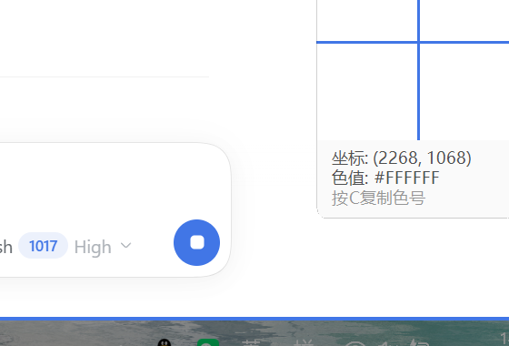
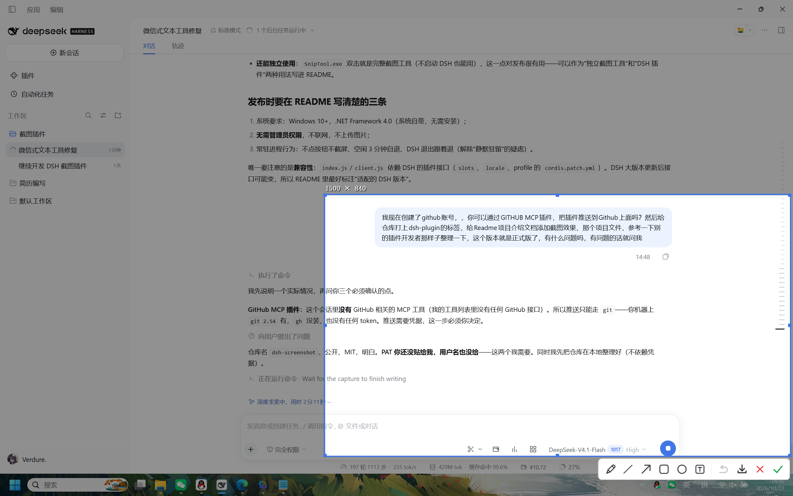

# dsh-screenshot

**English** — A WeChat/QQ-style screenshot tool for DeepSeek Harness on Windows: one click opens a full-screen region selector in about 0.2 s, with annotations, a colour picker and edge snapping. Confirming puts the image straight on the clipboard. The exe also works standalone.

**中文** — Windows 上对标微信 / QQ 截图的 **DeepSeek Harness 插件**：点一下就在约 **0.2 秒内**弹出全屏框选，可标注、取色、贴边吸附，确认后直接进剪贴板。exe 也可以脱离 DSH 单独使用。


## 特性 / Features

| English | 中文 |
|---|---|
| One click, ~0.2 s to the overlay (resident warm process) | 一秒弹出：常驻预热，唤醒 170–200 ms |
| Drag to select, window auto-detect, live size readout | 拖动框选、窗口高亮、尺寸实时显示 |
| Pen / line / arrow / rect / ellipse / text, `Ctrl+Z` undo | 画笔/直线/箭头/矩形/椭圆/文字，可撤销 |
| Three widths, colour swatches, solid fill | 三档粗细 + 取色板 + 纯色填充 |
| Magnifier with coordinates and hex, press `C` to copy | 放大器显示坐标与色值，按 `C` 复制色号 |
| Edge snapping keeps the selection inside the screen | 选区、控制点、文字都夹在屏幕内 |
| Right click cancels without leaking the desktop menu | 右键取消，不会露出桌面菜单 |
| Follows the DSH UI language (zh / en) | 跟随 DSH 界面语言（中 / 英） |
| ~6 MB idle, ~0.5 % CPU, exits when idle | 空闲约 6 MB、0.5 % CPU，空闲自动退出 |



## 安装 / Install

**English** — Requires Windows 10/11 and DeepSeek Harness. No administrator rights, no extra runtime (`.NET Framework 4.0` ships with Windows).

**中文** — 需要 Windows 10/11 和 DeepSeek Harness。不需要管理员权限，也不需要额外运行库（`.NET Framework 4.0` 系统自带）。

1. **English** — Put the repository under your plugins directory, e.g. `D:\dsh-home\plugins\dsh-screenshot`.
   **中文** — 把仓库放到插件目录，例如 `D:\dsh-home\plugins\dsh-screenshot`。

2. **English** — Add the bundle and a link entry to your DSH profile (`<DSH_HOME>/profiles/<name>/package.json`):
   **中文** — 在 DSH profile（`<DSH_HOME>/profiles/<name>/package.json`）里加入 bundle 与链接：

   ```json
   {
     "dsh": {
       "profile": {
         "bundles": ["@deepseek-ai/dsh-base", "@deepseek-ai/dsh-web-app", "dsh-screenshot"]
       }
     },
     "dependencies": {
       "dsh-screenshot": "link:D:/dsh-home/plugins/dsh-screenshot"
     }
   }
   ```

3. **English** — Restart DSH; a scissors button appears on the right of the composer.
   **中文** — 重启 DSH，输入框右侧会出现剪刀按钮。

## 使用 / Shortcuts

| 操作 / Action | 效果 / Effect |
|---|---|
| 点按钮或拖动 / Click or drag | 开始截图 / Start a capture |
| 单击 / Single click | 选中指针下的窗口 / Mark the window under the pointer |
| 拖控制点 / Drag a handle | 调整选区，放大器保持开启 / Resize, magnifier stays on |
| `Ctrl+Z` | 撤销上一笔 / Undo the last annotation |
| `C` | 复制指针处色号 / Copy the colour (`#RRGGBB`) |
| 回车 或 `✓` / `Enter` or `✓` | 复制并退出 / Copy and exit |
| `Esc`、右键、`✕` / `Esc`, right click, `✕` | 取消 / Cancel |

## 隐私与常驻进程 / Privacy and the resident process

**English** — No network requests, no telemetry, no uploads: the image only goes to the clipboard. The tool never captures the screen until you ask it to, exits after three idle minutes and follows DSH out of memory. Set `DSH_SNIP_DEBUG=1` to write `%TEMP%\dsh-text.log`; nothing is written by default.

**中文** — 不联网、无遥测、不上传：图片只进剪贴板。你不点按钮它就不截屏；空闲三分钟自动退出，DSH 退出后随之退出。排错时设置 `DSH_SNIP_DEBUG=1` 写 `%TEMP%\dsh-text.log`，默认不写任何文件。

## 实现 / Implementation

**English** — The plugin host keeps one resident `SnipTool.exe` and wakes it over a named pipe (`\\.\pipe\dsh-snip-show`), waiting for an explicit acknowledgement so a dead process is detected instead of silently ignored. Theme and UI language travel with each request. The overlay is drawn by hand: a double-buffered bitmap for the dimmed desktop and bright selection, a layered window for the toolbar, a small window for the magnifier.

**中文** — 插件 host 保持一个常驻 `SnipTool.exe`，通过命名管道（`\\.\pipe\dsh-snip-show`）唤醒并等待显式 ack：进程僵死能被立刻发现。主题与界面语言随请求下发。界面全部手绘：双缓冲位图负责压暗层与高亮选区，分层窗口负责工具栏，小窗口负责放大器。

```
bin/SnipTool.exe      prebuilt native tool / 预编译原生工具
src/SnipTool.cs       all C# source, single file / 全部源码，单文件
lib/index.js          plugin host: wake, theme, language / 唤醒与路由
lib/client.js         web button and menu / 网页按钮与菜单
cordis.patch.yml      plugin registration / 插件注册
```

| 指标 / Metric | 实测 / Measured |
|---|---|
| 预热后弹出 / Warm wake | 170–200 ms |
| 空闲预热后首次 / First wake after warm-up | 330–390 ms |
| 冷启动 / Cold start | ≈ 1.1 s |
| 空闲内存 / Idle working set | ≈ 6 MB |

**English** — Waking retries four times; if the resident process never acknowledges, a host-side watchdog kills only processes older than eight seconds and starts a fresh one. Every timer and mouse-hook callback checks for disposal, so a closing session cannot throw "cannot access a disposed object".

**中文** — 唤醒重试四次；若无响应，host 侧守护只杀存活超过 8 秒的进程再重启。定时器与鼠标钩子回调都检查对象是否已释放，关闭中的会话不会抛"无法访问已释放的对象"。

## 已知限制 / Limitations

**English** — Verified on a single display at 150 % scaling; mixed-DPI and multi-monitor setups are untested. Windows only. The UI language is read from the `locale` entry in the DSH profile, so a future layout change there needs a matching update here. Annotations can only be undone one by one.

**中文** — 仅在单屏 / 150% 缩放下验证；混合 DPI 与多屏未测试；仅支持 Windows；界面语言读取 DSH profile 里的 `locale` 配置，DSH 调整该结构时需同步更新；标注只能逐笔撤销，不能单独删除。

## 开发 / Development

```powershell
csc /nologo /target:winexe /optimize+ /out:bin\SnipTool.exe `
    /r:System.dll /r:System.Drawing.dll /r:System.Windows.Forms.dll src\SnipTool.cs
```



## License

MIT
